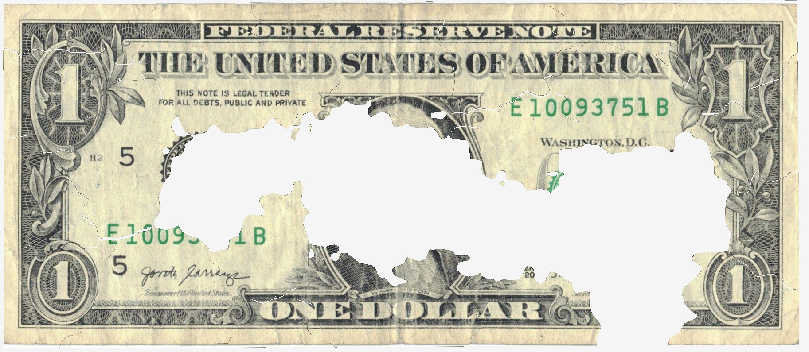
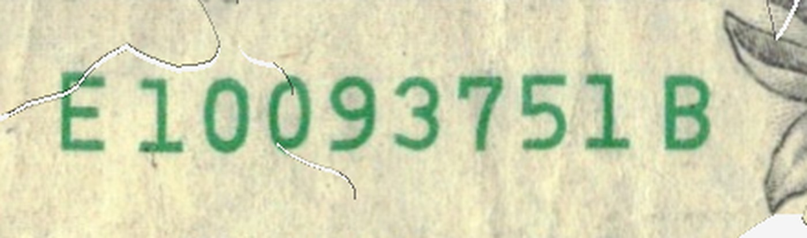
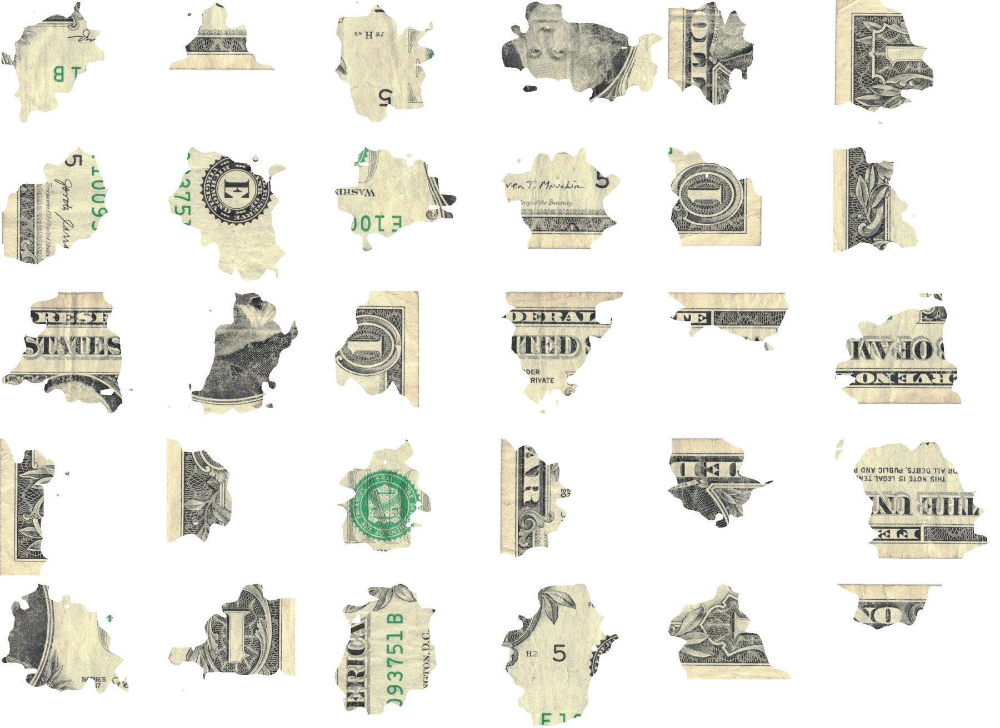
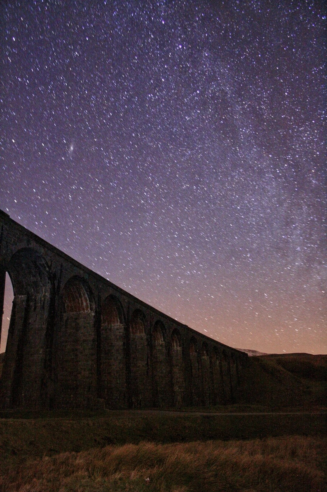
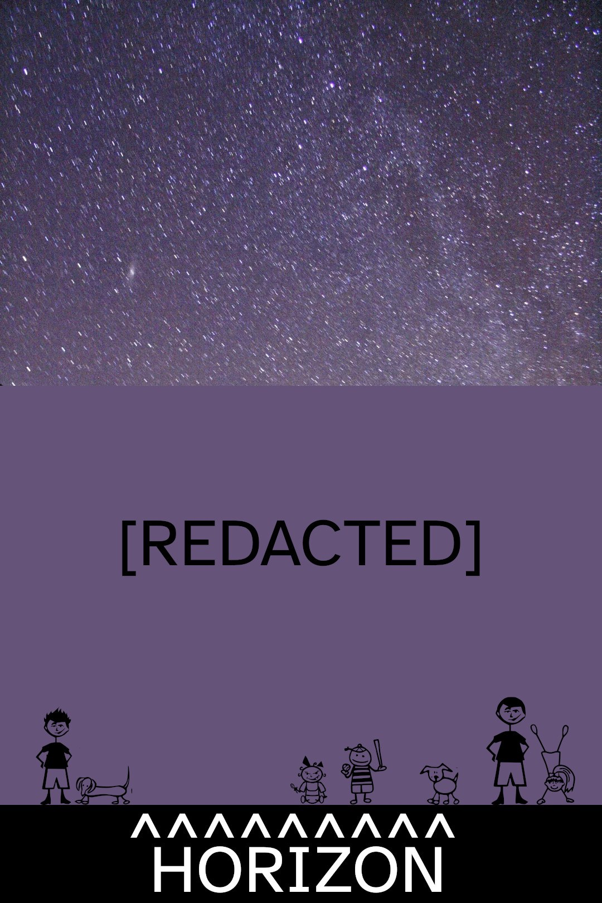
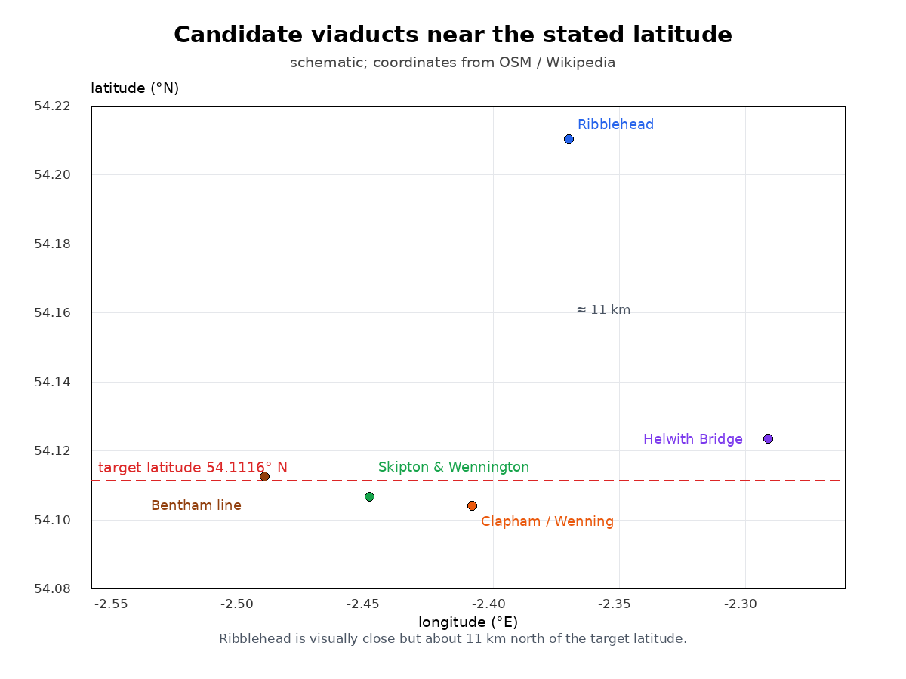
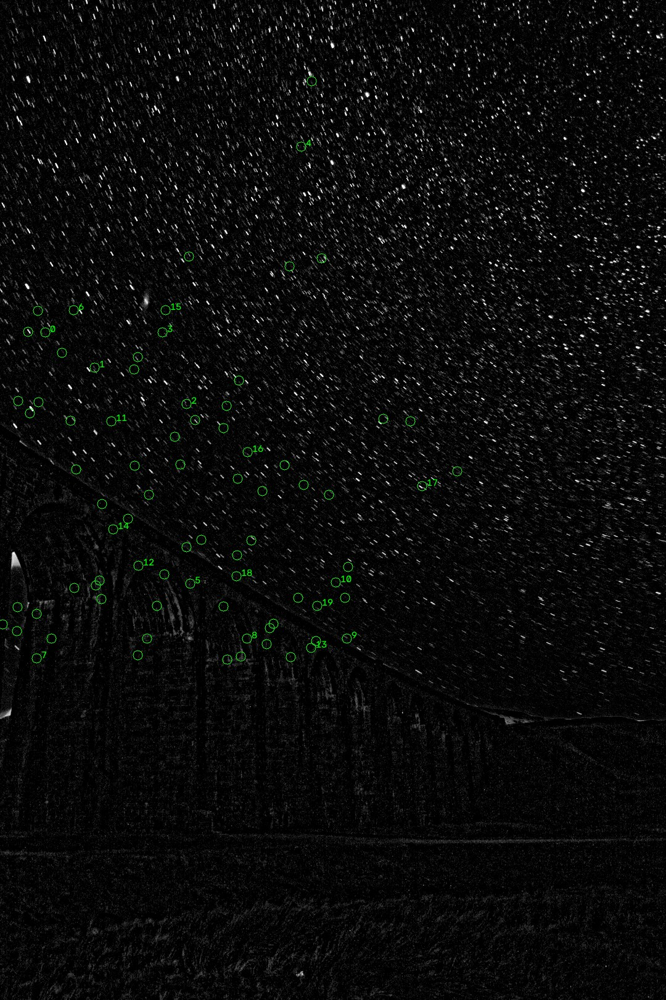
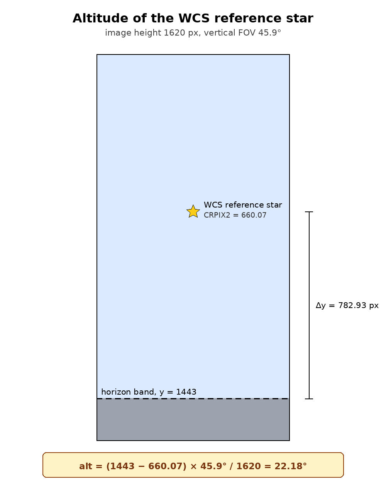
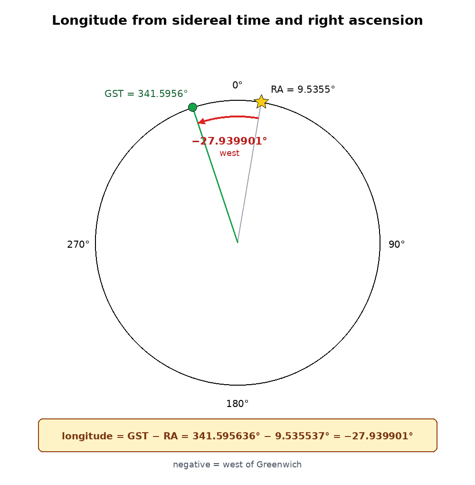

# Following the Money

| | |
|---|---|
| **Section** | wave 8 |
| **Category** | osint |
| **Solves** | 35 |

## Overview

A scanned $1 bill is split into thirty torn pieces. Reassembling the jigsaw gives the serial number, the serial leads to a Where's George report, and the report's note points to an astrophotography blog. The blog post contains a star field, a capture timestamp, the camera's field of view, and a second image where the horizon has been deliberately redacted.

The challenge is an OSINT chain, but the last step is astrometry: solve the star field, measure the altitude of the WCS reference star above the marked horizon, and combine that with the sidereal time at the capture instant. This one took about six hours, most of it spent on the viaduct false lead and on the difference between the star at the image centre and the star at the WCS reference pixel.

## Solve

**The fragments.** The thirty PNGs are torn fragments with alpha masks. Sorting them by edge shape and matching the engraved lines reconstructs the bill. The serial number is printed twice, in green, at the top right and bottom left:



A close-up makes the characters unambiguous:



The serial is `E10093751B`. The `E` prefix is the Federal Reserve district letter for Richmond, the trailing `B` is the block letter, and the bill is a 2017 series $1 with Jovita Carranza's signature. The contact sheet of the original pieces is useful for checking the overlap:



**Where's George.** The challenge supplies `b:Fuzhs8rJ7u`. The direct report URL is

```text
https://www.wheresgeorge.com/report.php?b=Fuzhs8rJ7u
```

The report's note points to the author's blog:

```text
https://pointeroverflowctf.com/challenges/following-the-money/astroblog/
```

The bill's travel history contains several hits, but the note is the only part of the report used in the chain.

**The blog.** The blog has one relevant post, #137, "The viaduct, finally clear". Its caption gives the capture time:

```text
2024-10-12T21:18:38Z
```

The page states that the image is 1620 pixels tall and was taken with a 45.9° vertical field of view. It also includes two images: the star field, and a second version with the horizon marked. The second image is a joke: the lower half is covered by a purple `[REDACTED]` panel, a row of cartoon figures sits above it, and a black band labelled `HORIZON` marks the horizon. The horizon is not drawn as a line; the black band is the marker, at pixel row `y = 1443`.





**The viaduct trap.** The obvious move is to identify the viaduct. The latitude is given as 54.1116 N, which points at the Yorkshire Dales / Lancashire / Cumbria border. We compared Ribblehead, Clapham/Wenning, the unnamed Skipton & Wennington viaduct, the Helwith Bridge group, and the Bentham line. Ribblehead is visually close but sits about 11 km north of the stated latitude. Clapham is close in latitude but has fewer arches and a different curve. None of the candidates fits both the latitude and the perspective. The viaduct is a red herring: the challenge never asks for the viaduct, it asks for the camera's longitude.



The search log records the coordinates, the rejected candidates, and the failed queries.

**Astrometry.** The star field is the real sensor. Astrometry.net solves the image and returns a WCS. The reference point is not the star at the image centre; it is the WCS reference star at `CRPIX`:

```text
CRVAL1 =   9.5355366203°   (RA)
CRVAL2 =  31.2660622861°   (Dec)
CRPIX1 =  63.2815876007
CRPIX2 = 660.067301432
```

The annotated overlay shows the matched stars:



**The altitude.** The reference star's pixel row is `660.067301432`. The horizon is at row `1443`. With a 45.9° vertical FOV over 1620 pixels, the star's altitude above the horizon is

```text
alt = (1443 - 660.067301432) * 45.9 / 1620
    = 22.1831°
```



**The longitude.** The capture time gives the Greenwich sidereal time:

```text
GST = 280.46061837 + 360.98564736629 * (t - J2000) / 86400  (mod 360)
```

At `2024-10-12T21:18:38Z`, `GST = 341.595636°`. The hinted longitude formula is

```text
longitude = GST - RA
          = 341.595636 - 9.535537
          = 332.060099°  ->  -27.939901°
```



Submitting `-27.939901` is accepted and returns the challenge flag:

```text
████████████████
```

**What did not work.** The full spherical branch, using the altitude and the latitude to recover the hour angle, produces a different longitude and was rejected. The star at the image centre also produces a different longitude. The accepted path is the literal `GST - RA` using the WCS reference star. The search log has the details.

**Reproduce it.** The raw measurements are in [`notes/measurements.md`](notes/measurements.md), the full search log is in [`notes/search-log.md`](notes/search-log.md), and the calculation can be reproduced with [`scripts/solve_longitude.py`](scripts/solve_longitude.py). The diagrams are generated by [`scripts/make_diagrams.py`](scripts/make_diagrams.py). Image credits are in [`credits.md`](credits.md).

The longitude is -27.939901°.
